<div align="center">

 LangChain > AI Agents" />

<a href="https://github.com/Amigosazul">
  <picture>
    <source media="(prefers-color-scheme: dark)" srcset="https://readme-typing-svg.demolab.com?font=Press+Start+2P&size=15&duration=2800&pause=900&color=FFF1E8&center=true&vCenter=true&width=640&height=48&lines=PLAYER+1+READY...;LOADING+PYTHON+SKILLS...;NEXT+STAGE%3A+LANGCHAIN;NEW+QUEST%3A+BUILD+AI+AGENTS" />
    
  </picture>
</a>

<p>
  
  
</p>

</div>

<br />


```text
PLAYER  : Amigosazul
CLASS   : Learner            // 学习者
QUEST   : Python > LangChain > AI Agents
SKILL   : Learning in public // 把学习笔记整理成小而实用的入门教程
STATUS  : Issues welcome     // 欢迎来仓库提 Issue、交流学习心得
```


<p>
  
  <br />
  
  
</p>


<p align="center">
  <a href="https://github.com/Amigosazul/Python-Basics-for-LangChain">
    
  </a>
</p>

> **[QUEST 01] [Python-Basics-for-LangChain](https://github.com/Amigosazul/Python-Basics-for-LangChain)**
> 学 LangChain 之前必须掌握的 Python 知识点，16 个小章节，每章都有可以直接运行的示例。
> The Python you actually need before learning LangChain, in 16 short chapters with runnable examples.


<p align="center">
  
  
</p>


<p align="center">
  
</p>

<br />


