<div align="center">

 LangChain > AI Agents" />

<a href="https://github.com/Amigosazul">
  
</a>

<p>
  
  
</p>

</div>


**玩家信息**

```text
PLAYER  : Amigosazul
CLASS   : Learner            // 学习者
QUEST   : Python > LangChain > AI Agents
SKILL   : Learning in public // 把学习笔记整理成小而实用的入门教程
STATUS  : Issues welcome     // 欢迎来仓库提 Issue、交流学习心得
```


**装备栏**

<p align="center">
  
</p>

<p align="center">
  
  
</p>


**任务日志**

<p align="center">
  <a href="https://github.com/Amigosazul/Python-Basics-for-LangChain">
    
  </a>
</p>

> **[QUEST 01] [Python-Basics-for-LangChain](https://github.com/Amigosazul/Python-Basics-for-LangChain)**
> The Python you actually need before learning LangChain: 16 short chapters, each with runnable examples.
> 学 LangChain 之前必须掌握的 Python 知识点，16 个小章节，每章都有可以直接运行的示例。


**角色属性**

<p align="center">
  
</p>

<p align="center">
  
</p>


